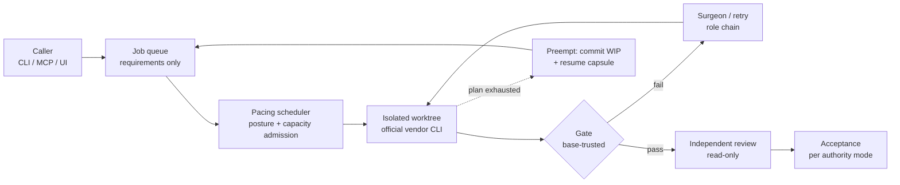

# SaberOps

[](https://github.com/sabers13/SaberOps/actions/workflows/ci.yml)
[](LICENSE)

[](https://github.com/sabers13/SaberOps/releases)

**A plan-aware execution engine that turns your AI coding subscriptions into verified commits.**

You (or any of your own agents) submit coding tasks. SaberOps runs them through
the vendors' **official CLIs, within each subscription's plan limits**, isolates
every attempt in its own Git worktree, verifies the result with deterministic
gates and an independent review, and hands back **accepted commits with
evidence**: during the day and while you sleep.

> **Core principle: LLMs advise; deterministic software decides.**

> [!IMPORTANT]
> v0.4.0 is a direction change. SaberOps is no longer a chat/workspace
> application. It is a **headless engine**
> ([ADR-0001](docs/decisions/0001-saberops-engine-mcp-first.md)) driven through
> the `orch` CLI, an **MCP server** and a local first-run web UI. It is still
> **preview software**: interfaces can change and it is not production-ready.

---

## Contents

- [Why SaberOps?](#why-saberops)
- [How it works](#how-it-works)
- [What's in the engine](#whats-in-the-engine)
- [Interfaces](#interfaces)
- [Worker adapters](#worker-adapters)
- [Authority modes](#authority-modes)
- [Installation](#installation)
- [Quick start](#quick-start)
- [Security and execution boundaries](#security-and-execution-boundaries)
- [Development](#development)
- [Current limitations](#current-limitations)
- [Documentation map](#documentation-map)

---

## Why SaberOps?

A coding agent can propose a patch. The hard part is everything around it:

- **Spending plans, not tokens.** Pace work across Codex, Claude, OpenCode and
  other subscriptions so it fits each plan's 5-hour, weekly and monthly windows,
  without falling back to pay-per-token billing or tripping a vendor's terms.
- **Trusting the result.** Knowing the patch was produced by the intended model,
  against the intended base commit, passed a gate the worker could not tamper
  with, and was reviewed by an independent model family.
- **Running unattended.** Parking what only the owner can decide, continuing
  what is independent, and producing a morning report instead of a silent stall.

SaberOps keeps semantic work (models) separate from execution authority
(deterministic code):

| Models propose | SaberOps decides |
| --- | --- |
| The Orchestrator proposes plans, waves and tasks | Validates the plan, scores waves, admits lanes with disjoint write scopes |
| Workers propose implementation commits | Chooses the route from role chains, plan capacity and billing posture |
| Reviewers give an independent read-only verdict | Owns worktrees, gates, provenance, durable state and acceptance |
| Nobody accepts their own work | Fails closed whenever required evidence is missing |

---

## How it works



1. **Submit.** A job states *requirements* (role, capabilities, read-only,
   model-family constraints, size, priority, deadline), never a provider,
   model or billing route.
2. **Admit.** The scheduler admits a route only if its billing posture is
   owner-verified and unexpired and its capacity pool has headroom. Among
   admitted routes it picks by pacing score: spare capacity per hour until the
   binding window resets.
3. **Isolate.** Each attempt gets its own Git worktree and a hermetic child
   environment. The worker cannot leave the worktree, rewrite Git control files
   or touch owner/host configuration.
4. **Verify.** A gate defined by the *base* commit decides; a candidate that
   edits the gate, `conftest.py` or gate scripts is refused.
5. **Review.** An independent, read-only reviewer from a different model family
   assesses the candidate.
6. **Accept.** A verified candidate integrates fast-forward only, followed by a
   post-integration gate, under the configured [authority mode](#authority-modes).
7. **Preempt and resume.** If a plan runs out mid-run, the work in progress is
   committed to a checkpoint ref with a resume capsule and re-queued until the
   window resets.

---

## What's in the engine

| Area | What it does | Docs |
| --- | --- | --- |
| **Jobs and scheduler** | Durable job queue (URGENT > NORMAL > BACKGROUND, deadline, FIFO), idempotency keys, single-instance scheduler lease, atomic dispatch | [operations](docs/operations.md#jobs) |
| **Plan registry and billing posture** | Accounts → pools → windows; per-route posture class (A/B/C/D/X) with policy URL, owner verification date and TTL. Unverified or expired routes are never admitted unattended | [operations](docs/operations.md#plans-and-billing-posture) |
| **Capacity ledger** | Usage observations, vendor exhaustion errors and learned per-job cost (EWMA by S/M/L size) feed admission and pacing | [operations](docs/operations.md#capacity-ledger-inspection-orch-capacity-show) |
| **Role-chain routing** | Ordered fallback groups per role: WORKER, SURGEON, INTEGRATOR; owner-selected Orchestrator and Reviewer bindings; exact provider/backend/model identity end to end | [operations](docs/operations.md#worker-routing-policy) |
| **Quota preemption** | Plan exhaustion classifies to `QUOTA_EXHAUSTED` with a reset time; WIP is anchored to create-only checkpoint refs and resumed from the capsule | [waves](docs/waves.md#quota-preemption--auto-resume-wx-2--m2-5) |
| **Waves and lanes** | Plans run as waves of lanes with disjoint write scopes, sequential pinned-SHA merges and one gate per wave; at most 3 active projects × 5 child tasks (owner-adjustable ceilings) | [waves](docs/waves.md), [wave optimization](docs/wave-plan-optimization.md) |
| **Gates G1 / G2 / G3** | Base-trusted gate profiles, gate slots sized to free RAM, gate history, coverage-mapped affected gate and a single-pass full gate | [gate](docs/gate.md), [operations](docs/operations.md#engine-run-gates-g1--g2--g3-and-the-history-ledger) |
| **Owner questions** | The engine never guesses an owner decision: keyed questions with a five-part escalation, answered verbatim from the CLI, web UI or Telegram | [questions](docs/questions.md) |
| **Unattended plans** | Frozen decision sheet, never-delegable list, three autonomous decision classes, circuit breaker, stall alarm and morning report. Unattended runs can never push | [unattended](docs/unattended-plans.md) |
| **Orchestrator memory** | Bounded startup digest, size-bounded notebook with archive, single-writer session lock, turn admission and context rotation at 50% of the window | [memory](docs/orchestrator-memory-restart.md), [turns](docs/orchestrator-turn-policy.md) |
| **Project entry modes** | Six modes (`new_project`, `develop_existing`, `continue_saberops`, `task`, `resume_run`, `inspect`) qualified from repository facts with a blocker preflight | [project modes](docs/project-modes.md) |
| **Roadmap change requests** | Idea intake, triage, frozen-step guard and impact checks without disturbing running waves | [roadmap changes](docs/roadmap-change-requests.md) |
| **Storage lifecycle** | Owner-aware inventory, retention and guarded GC of worktrees, branches, checkpoint refs and evidence; dry-run first, never `--force` | [storage](docs/storage-lifecycle.md) |
| **Central configuration** | Declarative workflow settings with an append-only, owner-approved decision ledger | [config](docs/config.md) |
| **Certification** | `orch certify` evaluates Q4 dogfooding criteria and nine resilience scenarios | [certification](docs/end-certification.md) |

---

## Interfaces

| Surface | Use it for |
| --- | --- |
| **`orch` CLI** | Everything. Every owner-facing command supports `--json` for agents and scripts. |
| **MCP server** (`orch mcp serve`, stdio; `orch connect` registers it in agent CLIs) | The primary integration surface for other agents: off until the user says "turn on saberops", then 12 tools to submit and inspect jobs and waves, read evidence, list/answer questions and propose configuration changes. `submit_job` rejects provider, model and billing fields. See [MCP](docs/mcp.md). |
| **Web UI** (`orch ui`) | Localhost first-run onboarding (readiness, vendor logins, model discovery, billing-posture attestation), routing and concurrency, project registration, plan/wave scoring, question queue, run monitoring with live events, and storage cleanup with typed confirmation. See [first-run web UI](docs/first-run-web-ui.md). |
| **Telegram** (optional) | Notifications for questions, gate completions and wave milestones; status queries from stored records; keyed `/answer` replies. Inert without a bot token. See [Telegram](docs/telegram.md). |

---

## Worker adapters

All model execution goes through the vendors' official CLIs or an explicitly
configured direct API. SaberOps never extracts OAuth tokens or impersonates a
CLI.

| Adapter | Automatic routing | Notes |
| --- | :---: | --- |
| Codex CLI | Yes | User config ignored on every invocation; billing-relevant settings pinned |
| Claude Code CLI | Yes | Subscription login checked before each task; API/gateway overrides stripped; Fast mode disabled; user/project settings excluded |
| OpenCode | Yes | Isolated config/plugin root per child; billing-relevant settings pinned |
| Cline | Yes | |
| Direct API (OpenAI-compatible, incl. OmniRoute) | Yes | Bounded tool loop; billed to the API account (posture class D, never scheduled unattended) |
| Antigravity | **No** | Attended-only: used only when the owner explicitly selects provider and model for a run |

The Copilot adapter was removed in v0.4.0. "Implemented" means the adapter
exists and is covered by hermetic tests replaying recorded CLI fixtures; it does
not mean every adapter has been live-certified against every account. The
owner-run [vendor CLI live check](docs/vendor-cli-live-check.md) detects CLI
drift without sending prompts or reading credentials.

---

## Authority modes

How much SaberOps may do without asking is an explicit, persisted owner setting.
Unknown values fail closed and never degrade into a more permissive mode.

| Mode | May accept verified candidates without asking | Publishes candidate branch |
| --- | :---: | :---: |
| `ask_before_actions` | No | No |
| `supervised` (default) | No | No |
| `autonomous` | No | Yes |
| `full_autonomy` | Yes | Yes |
| `full_autonomy_publish` | Yes | Yes |

Acceptance never bypasses verification. Unattended acceptance is limited to a
local commit; no autonomous decision can move a remote. Inspect or change the
mode with `orch authority show|list|set`.

---

## Installation

Requirements: Python **3.12+**, Git, and for real runs the relevant vendor CLIs
installed and logged in through the vendor's own mechanism. SaberOps ships no
model, and its tests and CI make no provider calls.

Install it as a tool, so `orch` is on your `PATH` for every shell and every
agent CLI:

```bash
uv tool install git+https://github.com/sabers13/SaberOps.git@v0.5.0
# or: pipx install git+https://github.com/sabers13/SaberOps.git@v0.5.0
orch --help
```

Upgrade later with `uv tool upgrade saberops` (or `pipx upgrade saberops`).

### One-time setup

```bash
orch ui            # http://127.0.0.1:8765
orch connect all   # register SaberOps in Claude Code, Codex, Antigravity, OpenCode, Cursor
```

In the web UI: **Setup** signs you in and finds your models, **Accounts**
confirms how each subscription is billed (**Confirm all**, once), and
**Routing** chooses which model writes, checks, repairs and combines. Then open
a new session in your agent and say **"turn on saberops"**; say **"turn off
saberops"** to go back to a normal agent. Messages from SaberOps start with
`Orchestrator:`. `orch mcp off` hides SaberOps from every agent.

For development, from a clone:

```bash
git clone https://github.com/sabers13/SaberOps.git && cd SaberOps
python3.12 -m venv .venv && source .venv/bin/activate
python -m pip install -e ".[dev]"
```

---

## Quick start

**1. Onboard.** Start the local web UI. On an empty store it opens the
first-run wizard:

```bash
orch ui            # http://127.0.0.1:8765
```

Or do the same from the CLI:

```bash
orch doctor --repo /path/to/project   # read-only readiness checks
orch access list                      # model-access connections
orch access discover <connection>     # record discovered models (evidence only)
orch plans show                       # accounts, pools, windows, postures
orch posture verify codex --url <policy-url>   # attest a route's billing posture
orch routing show                     # WORKER / SURGEON / INTEGRATOR chains
orch authority show
```

Routes stay unadmitted until their billing posture has been verified with
`orch posture verify`. Run `orch <command> --help` for every option.

**2. Configure the project** gate and policies:

```bash
orch project set-gate --repo /path/to/project "pytest -q"
orch project show --repo /path/to/project
```

**3. Run work.** Either run one task directly:

```bash
orch run --repo /path/to/project \
  --task "Add input validation to the CSV importer" \
  --gate "pytest -q" --review
```

or queue jobs and let the pacing scheduler dispatch them within plan limits:

```bash
orch job submit --repo /path/to/project --goal "Fix the login retry" \
  --acceptance "gate passes" --size M --idempotency-key login-1
orch scheduler run                    # or --once for a single tick
orch capacity show
```

**4. Inspect and accept.**

```bash
orch list
orch report <run_id>       # canonical read-only run report (--json available)
orch monitor <run_id>      # follow live
orch questions list        # anything waiting on you
orch accept <run_id>
orch gc --dry-run          # preview storage cleanup
```

**5. Connect another agent over MCP:**

```bash
orch mcp tools --json      # list the 12 tools and their schemas
orch mcp serve             # JSON-RPC 2.0 over stdio
```

Runtime state, databases, worktrees and logs live outside the package in XDG or
project-local locations; commands that touch run state accept `--db PATH`.

---

## Security and execution boundaries

- **Worker isolation.** Every worker effect must resolve inside its worktree or
  declared scratch roots; `..`, symlink escapes, Git control-surface writes and
  host configuration (`~/.ssh`, `~/.gitconfig`, `/etc`, …) are refused. Workers
  run with an explicit `worker` session authority, a scratch `HOME` and neutral
  Git configuration. See [security](docs/security.md).
- **Owner actions.** Review and accept can only be executed under owner session
  authority; an automated worker session fails closed.
- **Local web guard.** The UI binds to localhost, enforces a loopback `Host`
  allowlist, and requires a CSRF token on every mutation.
- **Credentials.** Authentication stays with each vendor. The UI has no
  password or token field; credential references may be stored, secret values
  are not. Child environments are allowlisted so API keys cannot leak into a
  subscription run.
- **Gate integrity.** Gates come from the base commit; candidates touching gate
  definitions are blocked.
- **Fail closed.** Missing posture, capacity, ownership or provenance evidence
  means refusal, never an inferred approval.

Worktree isolation separates candidate changes; it is not an operating-system
sandbox against a worker granted `unrestricted` host access
(`orch authority set-host-access`).

---

## Development

```bash
python -m pip install -e ".[dev]"

ruff check .
mypy --strict src tests
pytest -q
```

GitHub Actions runs the same three checks on Python 3.12 without provider
credentials. Repository gate wrappers:

| Script | Purpose |
| --- | --- |
| `scripts/gate-full.sh` | Authoritative milestone/merge gate: ruff, strict mypy, the full suite in one parallel pass |
| `scripts/gate-affected.sh` | Per-task gate: runs only tests that cover the changed lines (coverage map, with static fallback) |
| `scripts/lane-check.sh` | Cheap diff-targeted lane evidence for workers |
| `scripts/gate-ui-fast.sh` | Presentation-only template/asset checks for UI tweaks |
| `scripts/main-gate.sh` | Scheduled full gate with history and flaky-test report (systemd units in `scripts/systemd/`) |

Contributor and agent workflow rules, including the frontend modes, are in
[AGENTS.md](AGENTS.md); the visual language is in
[DESIGN.md](src/saberops/DESIGN.md).

```text
src/saberops/          engine package (capacity/, jobs/, control_plane/, mcp/,
                       sandbox/, workers/, templates/, static/, ...)
tests/                 hermetic test suite (no provider calls)
docs/                  design and operating documentation
scripts/               gate wrappers and tooling
```

---

## Current limitations

- **Preview.** Interfaces, storage schemas and workflows may still change; a
  downgrade is not a supported migration path.
- **Project-aware concurrency.** The scheduler enforces a global ceiling
  (default 15 running jobs); the 3 projects × 5 tasks policy is enforced by the
  wave executor and slot policy, not yet by the job scheduler itself.
- **Waves at runtime.** The wave executor does not yet replace the older
  parallel-team path for every run; MCP `submit_wave` performs structural
  admission only.
- **No governed publication.** Accepted work is not pushed automatically;
  `full_autonomy_publish` stops at the accepted state.
- **Adapter coverage.** Not every adapter/account combination has been
  live-validated; Antigravity is attended-only.
- **Merge conflicts** stop integration and preserve branches; automatic conflict
  repair is not implemented.

---

## Documentation map

- [v0.5.0 release notes](docs/releases/0.5.0.md) · [v0.4.0](docs/releases/0.4.0.md)
- [ADR-0001: engine direction](docs/decisions/0001-saberops-engine-mcp-first.md)
- Operating: [operations](docs/operations.md) · [config](docs/config.md) ·
  [storage lifecycle](docs/storage-lifecycle.md) · [security](docs/security.md) ·
  [vendor CLI live check](docs/vendor-cli-live-check.md)
- Execution: [waves](docs/waves.md) · [wave optimization](docs/wave-plan-optimization.md) ·
  [parallel work](docs/parallel-work.md) · [gate](docs/gate.md) ·
  [unattended plans](docs/unattended-plans.md) · [certification](docs/end-certification.md)
- Orchestrator: [parallel-first policy](docs/orchestrator-parallel-first.md) ·
  [turn policy](docs/orchestrator-turn-policy.md) ·
  [memory and restart](docs/orchestrator-memory-restart.md) ·
  [project modes](docs/project-modes.md) ·
  [roadmap changes](docs/roadmap-change-requests.md) · [questions](docs/questions.md)
- Interfaces: [MCP](docs/mcp.md) · [first-run web UI](docs/first-run-web-ui.md) ·
  [Telegram](docs/telegram.md) · [UI design principles](docs/ui-design-principles.md)

---

## License

Apache License 2.0. See [LICENSE](LICENSE) and [THIRD_PARTY_NOTICES.md](THIRD_PARTY_NOTICES.md).
