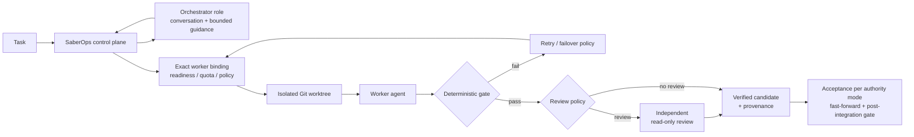

# SaberOps

[](https://github.com/sabers13/SaberOps/actions/workflows/ci.yml)
[](LICENSE)

[](https://github.com/sabers13/SaberOps/tags)

**A local control plane for supervised, multi-model AI engineering.**

SaberOps lets AI models propose software changes while deterministic code controls **what may run, which exact model is used, how work is isolated, what counts as success, and what may be accepted into the repository**.

> **Core principle: the LLM advises; deterministic software decides.**

> [!IMPORTANT]
> **v0.3.8 adds parallel Work with isolated worker branches and a Git & threads pane.** It also separates Chat from Work, keeps linked original chats, unifies project navigation, and improves native session controls and provider reporting. See the [release notes](docs/releases/0.3.8.md) and [parallel workflow guide](docs/parallel-work.md). This release is still **preview software**: not production-ready, stable, or complete.

---

## Why SaberOps?

A coding agent can propose a patch. The harder engineering problem is deciding whether that patch was produced under the right authority, by the intended model, against the intended repository state, and whether it is safe to accept.

SaberOps separates **semantic work** from **execution authority**:

| AI models | Deterministic SaberOps control plane |
| --- | --- |
| Orchestrator holds the owner conversation and proposes worker tasks | Validates exact provider/backend/model bindings |
| Worker model proposes implementation changes | Enforces routing admission, readiness, quota, and policy |
| Optional reviewer provides an independent read-only assessment | Owns Git worktrees, gates, provenance, durable state, and acceptance |
| Models never decide whether their own result is accepted | Fails closed when required evidence is missing |

---

## How it works



A normal run follows these boundaries:

1. **Admission.** SaberOps selects or validates an exact worker binding and checks the evidence required by routing policy.
2. **Isolation.** Each attempt gets its own Git worktree, keeping candidate changes separate from the source checkout.
3. **Execution.** The selected worker adapter receives the bounded task context and exact execution identity.
4. **Verification.** Your deterministic gate (for example `pytest -q` or `make gate`) decides whether the candidate passes.
5. **Review.** Review can be required explicitly or selected by a risk-adaptive policy; reviewers are read-only.
6. **Acceptance.** Only a verified candidate can be integrated, fast-forward only, followed by a post-integration gate. In the default `supervised` mode this requires an explicit `orch accept`; see [Authority modes](#authority-modes).
7. **Durability.** Run state, events, provenance, and decisions are persisted so interrupted runs can be inspected and reconciled.

---

## Key design decisions

### Exact execution identity

SaberOps preserves provider, backend, and model identity from discovery through binding and dispatch. Same-named models from different upstreams remain distinct, and exact bindings prevent silent sibling-model or first-match substitution.

### Conversational orchestration

The workspace composer starts a persistent conversation with the selected
Orchestrator. Questions and discussion receive replies without launching a
worker. **Turn into work** keeps the original chat and creates a separate linked
Work thread. Implementation requests in Work use the supervised worker flow under
project policy; completed or failed runs are explained in that Work thread.
Follow-ups retain the original objective and recent conversation context. Each
implementation request creates a separate candidate run against the project's
current base; previous unaccepted candidates are not integrated automatically.

Conversations are stored separately from run evidence, with exact Orchestrator
identity and invocation evidence. Page loads and message polling never invoke
models. Interrupted replies remain visible and are not replayed automatically.
The latest 20 messages, including the original objective, supply model context;
the full transcript remains stored. Run screens can continue into a conversation.

Result conversations receive the canonical candidate file list, matching worker
handoff, persisted gate output and reviewer responses alongside the run report.
These reads do not run project code or integrate changes. Long evidence is
explicitly truncated, retaining log beginnings and final results within a shared
budget. Worker prose remains advisory; gate/review records and acceptance evidence
retain their existing authority. Fresh artifacts supersede earlier conversational
claims about missing files or test output. A gate PASS does not prove browser
verification, and a completed run remains separate from owner acceptance.

A run blocked by UNKNOWN worker readiness exposes an explicit “Try” action for
an exact worker still in the owner-picked routing chain. It launches a new run
through the existing explicit-override authority and retains the failed run's
frozen validation policy. It never marks installation as readiness; a successful
execution records readiness for the exact connection. Automatic routing continues
to refuse UNKNOWN readiness.

A failed run with a saved candidate exposes **Continue from saved work**. This
creates a linked repair run in a new worktree at that candidate; the failed run
and the project's original checkout remain intact. It carries forward the task,
frozen execution policy, gate errors, review findings, and any durable plan with
completed prerequisites. Verification covers the full candidate against the
original project base, with review enabled unless the owner explicitly disabled
it. Acceptance remains a separate owner action. Repeated clicks open the same
continuation. Changed or missing source work, unresolved execution effects, and
live or uncertain previous workers block continuation. **Retry** starts fresh
from the project base instead. Continue does not reopen a finished provider turn.

### Separate Orchestrator and worker roles

The Orchestrator role and worker models use separate role-bound execution bindings. Changing the Orchestrator selection does not reorder worker routing, and a worker-role binding cannot be used as the Orchestrator binding.

### Provenance before acceptance

A candidate is tied to the run, objective, and base revision that produced it. Acceptance is based on verified provenance, not simply on the existence of an agent-generated commit.

### Truthful capability handling

SaberOps does not invent model capabilities. If no controllable reasoning-effort tier is known and no tier was explicitly requested, the provider default is used. Explicit unsupported requests fail closed.

### Connections are not authorization

Saving or probing a provider connection does not authorize execution. Discovery, exact binding, readiness, and routing admission remain separate checks.

---

## Authority modes

How much SaberOps may do without asking is an explicit, persisted owner setting. Unknown mode values fail closed and never degrade into a more permissive mode.

| Mode | May accept verified candidates without asking | Publishes candidate branch |
| --- | :---: | :---: |
| `ask_before_actions` | No | No |
| `supervised` (default) | No | No |
| `autonomous` | No | Yes |
| `full_autonomy` | Yes | Yes |
| `full_autonomy_publish` | Yes | Yes |

Acceptance authority never bypasses verification; a candidate must still satisfy the fail-closed acceptance requirements. `full_autonomy_publish` additionally grants publication of accepted work, but v0.3.8 has no governed publication command, so it stops at the accepted state. Inspect or change the mode with `orch authority show`, `orch authority list`, and `orch authority set`.

---

## Requirements

- Python **3.12+**
- Git
- For real provider-backed runs: the relevant provider CLI installed and authenticated through that provider's normal mechanism

SaberOps does not ship a model and does not require provider credentials for its test suite or CI.

---

## Installation

```bash
git clone https://github.com/sabers13/SaberOps.git
cd SaberOps

python3.12 -m venv .venv
source .venv/bin/activate
python -m pip install .

orch --help
```

For development:

```bash
python -m pip install -e ".[dev]"
```

---

## Quick start

Inspect your local environment and a target repository:

```bash
orch doctor --repo /path/to/project
orch models
orch authority show
```

Start the local dashboard with an isolated first-run profile (binds to `127.0.0.1:8765` by default):

```bash
orch ui --profile first-run
```

At launch, SaberOps detects CLIs on PATH and in common user installation folders
(including OpenCode and nvm), then runs supported native login-status commands
with a timeout. The same PATH is used to launch workers. Antigravity (`agy`) is
included in Access, with native model discovery. Installation and model catalogs
do not prove login. Copilot verifies its existing account through the native
`auth.getStatus` control request, alongside Codex and Claude's status commands.
Unsupported CLI versions truthfully remain unverified.
Startup does not send model prompts, read CLI credentials or choose routing.

Before your first task, open Providers and refresh models. For OpenCode and
Antigravity, choose an exact model and use **Verify model access**. This explicit
action sends one small request using the CLI's existing account setup and consumes
account allowance. It runs in a temporary directory with native tools denied,
outside your project, with a 45-second deadline and process cleanup. A completed
challenge response saves readiness and the tested model; installation, catalogs,
empty output and exit zero alone never establish access. Checks are never
started automatically. For sign-in, the page gives the provider's native login
instructions. A failed test of another model retains earlier successful evidence.
Readiness follows the existing connection-level 24-hour freshness policy; one
model's success does not prove entitlement or remaining quota for every catalog
model, particularly across OpenCode upstream providers.

Access model refresh also supports Claude Code’s native initialize catalog and
Copilot’s native `models.list` control request. These metadata-only calls use the
installed CLI’s own account session, run in a temporary working directory, and
never send an inference prompt. CLI/version failures retain stale evidence rather
than manufacturing model names or authentication readiness.

Saved API connections are visible directly in Access. OpenRouter discovery uses
`https://openrouter.ai/api/v1/models`, including when a saved connection points at
another OpenRouter API surface. Other OpenAI-compatible connections accept base,
model-list, chat-completions, and responses URLs. OpenAI-compatible API models
can execute directly in worker, reviewer and orchestrator roles after discovery
and explicit selection in Routing. Subscription connections continue through
their native CLI harnesses; an API connection never borrows subscription credentials.

Configure an API connection with an `env:MY_API_KEY` reference, and make that
variable available to the SaberOps process before starting it (including the
service environment when launched as a service). Secret values are neither saved
in connection/binding documents nor logged. `profile:`/`store:` references and
other API protocols currently have no direct executor and remain unavailable.
Verify API and Refresh models are metadata-only requests that may transmit the
referenced API key to the configured endpoint. OpenRouter verification uses its
read-only `/api/v1/key` endpoint. A generic `/models` success proves catalog
reachability, not authentication or entitlement to every listed model. Missing
credentials fail closed with `CREDENTIAL_MISSING`; discovery never selects a role.

Direct API workers use a bounded tool loop with worktree file tools and command
execution. Reviewers and orchestrators get read-only file tools. The existing
monitored process boundary handles stop/deadline controls and records actual
response usage; autonomous containment requirements continue to apply. API models
must support Chat Completions and function tools; unsupported responses fail
explicitly. These calls consume the API account's billing, independently of CLI
subscriptions. API verification and model discovery perform no inference; the
separate native **Verify model access** action is an explicit inference check.

Claude account execution launches the installed `claude` CLI and retains its
native tools, agent loop, and system prompt. It checks the CLI’s subscription
login before sending the task, removes API/gateway/cloud-provider overrides from
the child environment, and disables Fast mode. It never extracts OAuth tokens,
implements an Anthropic HTTP transport, or retries a refused subscription call
through a paid API. User/project settings are excluded for this connection so
they cannot change the billing source; managed provider policies still apply.
Tasks consume the account’s normal usage allowance. Disable usage credits in your
Claude account if you require no additional charges: native CLI use alone cannot
guarantee subscription terms or zero additional provider billing.

Then use **First-run setup** in the UI to discover providers/models, choose Worker/Reviewer/Orchestrator roles, select the target repository, and configure project policy.

Project policy includes **Quick**, **Balanced** (default), **Thorough**, **Max**,
and manual settings. Quick disables gate and independent review. Balanced
requires a configured gate and uses risk-adaptive review with 3 reviewer calls;
Thorough requires gate and review with 5 calls. Max requires both without an
owner-set reviewer-call limit, while runtime and failure bounds still apply.
Manual settings let you choose gate required/disabled, review disabled/adaptive/
required, and bounded/Max review. Required gates need a configured command or a
Makefile `gate:` target. Settings freeze at run creation, including acceptance;
skipped checks are recorded as SKIPPED, never PASS.

### Example provider-backed run

After installing and authenticating a supported provider CLI:

```bash
orch run \
  --repo /path/to/project \
  --task "Add input validation to the CSV importer" \
  --gate "pytest -q" \
  --review
```

Then inspect and, if appropriate, accept the verified result:

```bash
orch status <run_id>
orch events <run_id>
orch report <run_id>   # Canonical read-only run report (text, or --json for the deterministic payload)
orch monitor <run_id>  # Follow a run live with the canonical projection (read-only)
orch accept <run_id>
orch cleanup <run_id>
```

Run `orch <command> --help` for the full command and option reference. Runtime state, databases, worktrees, and logs live outside the installed package in XDG or project-local locations. Commands that operate on run state accept `--db PATH` where applicable.

---

## Worker adapters

| Adapter | Implemented in the codebase |
| --- | :---: |
| Codex | Yes |
| Claude Code (native subscription CLI) | Yes |
| Copilot | Yes |
| Cline | Yes |
| OpenCode | Yes |
| Antigravity | Yes |

"Implemented" means the adapter exists in the codebase. It does **not** mean that every adapter has been live-certified against a real provider account in v0.3.8.

---

## Security and execution boundaries

- Provider authentication remains with the provider's normal mechanism. Credential references may be stored; secret values are not.
- Do not put credentials in source, committed configuration, or task text.
- The dashboard binds to localhost by default.
- Host access for workers is `governed` by default. `unrestricted` exists as an explicit owner choice (`orch authority set-host-access`); worktree isolation separates candidate changes, it is not a sandbox against a worker with unrestricted host access.
- Missing required admission evidence causes a refusal rather than an inferred approval.
- Tests and CI make no provider or model calls.

---

## Development

```bash
python -m pip install -e ".[dev]"

ruff check .
mypy --strict src tests
pytest -q
```

GitHub Actions runs the same checks on Python 3.12 without provider credentials or model calls.

Frontend iteration follows the five modes in [AGENTS.md](AGENTS.md), with current
UI direction and source evidence in [DESIGN.md](src/saberops/DESIGN.md).
With the existing development environment and Node.js available,
`bash scripts/gate-ui-fast.sh` runs the presentation-only template/asset checks;
`bash scripts/gate-full.sh` preserves the complete checks above for UI FINALIZE.
The wrappers use `.venv/bin/python` when present, otherwise the active `python`.
Use the fast gate only within the documented UI scope and after inspecting the
rendered result. The approved October reconstruction keeps the FastAPI/Jinja
frontend, with shared primitives and responsive light/dark styles in
`workspace.css`; no frontend build step is required.

### Repository layout

```text
src/saberops/            runtime package
tests/                   public capability tests
.github/workflows/       public CI
pyproject.toml           package metadata and tool configuration
LICENSE                  Apache License 2.0
THIRD_PARTY_NOTICES.md   shipped third-party notices
```

---

## Current limitations

- Parallel Work supports two to six tasks with up to four concurrent workers. Conflicts stop integration; automatic mid-team recovery and automatic conflict repair are not implemented. See the [workflow guide](docs/parallel-work.md).
- This is a preview release: interfaces and workflows may change.
- SaberOps is not production-ready, stable, or feature-complete.

---

## Further reading

- [v0.3.8 release notes](docs/releases/0.3.8.md): changes, upgrade instructions and validation.
- [Chat and Work guide](docs/chat-and-work.md): projects, separate conversations, attachments and linked Work.

- [Parallel Work and Git tracking](docs/parallel-work.md): team planning, isolated
  worker branches, ordered integration, checks and owner acceptance.
- [Operating notes](docs/operations.md): worker routing, CLI usage limits, the
  chat and agent consoles, and fixed-source candidate verification.
- [Session architecture](docs/session-architecture.md): native sessions,
  take-over and the capability boundary per provider.
- [UI design principles](docs/ui-design-principles.md).

---

## License

Apache License 2.0. See [LICENSE](LICENSE) and [THIRD_PARTY_NOTICES.md](THIRD_PARTY_NOTICES.md).
