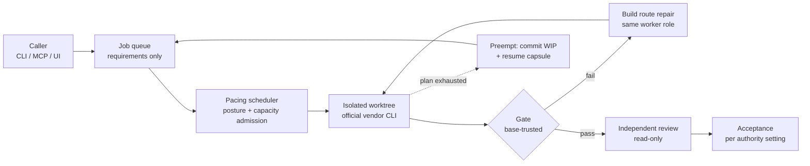

# SaberOps

[](https://github.com/sabers13/SaberOps/actions/workflows/ci.yml)
[](LICENSE)

[](https://github.com/sabers13/SaberOps/releases)

**A plan-aware execution engine that turns your AI coding subscriptions into verified commits.**

You (or any of your own agents) submit coding tasks. SaberOps runs them through
the vendors' **official CLIs, within each subscription's plan limits**, isolates
every attempt in its own Git worktree, verifies the result with deterministic
gates and an independent review, and hands back **accepted commits with
evidence**: during the day and while you sleep.

> **Core principle: LLMs advise; deterministic software decides.**

> [!IMPORTANT]
> v0.4.0 was a direction change. SaberOps is no longer a chat/workspace
> application. It is an **MCP-first engine**
> ([ADR-0005](docs/decisions/0005-mcp-first-engine-and-phase-2-board.md),
> superseding [ADR-0001](docs/decisions/0001-saberops-engine-mcp-first.md)) driven through
> the `orch` CLI, an **MCP server** and a local first-run web UI. A bounded board
> plus setup page is in scope as Phase 2, after the MCP core is complete and
> tested. It is still
> **preview software**: interfaces can change and it is not production-ready.

---

## Contents

- [Why SaberOps?](#why-saberops)
- [How it works](#how-it-works)
- [What's in the engine](#whats-in-the-engine)
- [Interfaces](#interfaces)
- [Worker adapters](#worker-adapters)
- [Authority settings](#authority-settings)
- [Installation](#installation)
- [Quick start](#quick-start)
- [Security and execution boundaries](#security-and-execution-boundaries)
- [Development](#development)
- [Current limitations](#current-limitations)
- [Documentation map](#documentation-map)

---

## Why SaberOps?

A coding agent can propose a patch. The hard part is everything around it:

- **Spending plans, not tokens.** Pace work across Codex, Claude, OpenCode and
  other subscriptions so it fits each plan's 5-hour, weekly and monthly windows,
  without falling back to pay-per-token billing or tripping a vendor's terms.
- **Trusting the result.** Knowing the patch was produced by the intended model,
  against the intended base commit, passed a gate the worker could not tamper
  with, and was reviewed by an independent model family.
- **Running unattended.** Parking what only the owner can decide, continuing
  what is independent, and producing a morning report instead of a silent stall.

SaberOps keeps semantic work (models) separate from execution authority
(deterministic code):

| Models propose | SaberOps decides |
| --- | --- |
| You plan in your own CLI session | Validates, builds, checks and accepts deterministically |
| Builders propose implementation commits | Chooses the route from the build chain, plan capacity and billing posture |
| Reviewers give an independent read-only verdict | Owns worktrees, gates, provenance, durable state and acceptance |
| Nobody accepts their own work | Fails closed whenever required evidence is missing |

---

## How it works



1. **Submit.** A job states *requirements* (role, capabilities, read-only,
   model-family constraints, size, priority, deadline), never a provider,
   model or billing route.
2. **Admit.** The scheduler admits a route only if its billing posture is
   owner-verified and unexpired and its capacity pool has headroom. Among
   admitted routes it picks by pacing score: spare capacity per hour until the
   binding window resets.
3. **Isolate.** Each attempt gets its own Git worktree and a hermetic child
   environment. The worker cannot leave the worktree, rewrite Git control files
   or touch owner/host configuration.
4. **Verify.** A gate defined by the *base* commit decides; a candidate that
   edits the gate, `conftest.py` or gate scripts is refused.
5. **Review.** An independent, read-only reviewer from a different model family
   assesses the candidate.
6. **Accept.** A verified candidate integrates fast-forward only, followed by a
   post-integration gate, under the configured [authority mode](#authority-modes).
7. **Preempt and resume.** If a plan runs out mid-run, the work in progress is
   committed to a checkpoint ref with a resume capsule and re-queued until the
   window resets.

---

## What's in the engine

| Area | What it does | Docs |
| --- | --- | --- |
| **Jobs and scheduler** | Durable job queue (URGENT > NORMAL > BACKGROUND, deadline, FIFO), idempotency keys, single-instance scheduler lease, atomic dispatch | [operations](docs/operations.md#jobs) |
| **Plan registry and billing posture** | Accounts → pools → windows; per-route posture class (A/B/C/D/X) with policy URL, owner verification date and TTL. Unverified or expired routes are never admitted unattended | [operations](docs/operations.md#plans-and-billing-posture) |
| **Capacity ledger** | Usage observations, vendor exhaustion errors and learned per-job cost (EWMA by S/M/L size) feed admission and pacing | [operations](docs/operations.md#capacity-ledger-inspection-orch-capacity-show) |
| **Role routing** | Three roles: **plan** (the CLI session you sit in), **build** (one worker per task, including repairs and a stronger-model `strong_start` setting on the build route) and **check** (an independent reviewer). Gates, landing, the memory and disk guard and cleanup are deterministic engine stages, not roles | [operations](docs/operations.md#build-routing-policy) |
| **Gates G1 / G2 / G3** | Base-trusted gate profiles, gate slots sized to free RAM, gate history, coverage-mapped affected gate and a single-pass full gate | [gate](docs/gate.md), [operations](docs/operations.md#engine-run-gates-g1--g2--g3-and-the-history-ledger) |
| **Owner questions** | The engine never guesses an owner decision: keyed questions with a five-part escalation, answered verbatim from the CLI or web UI | [questions](docs/questions.md) |
| **Unattended plans** | Frozen decision sheet, never-delegable list, three autonomous decision classes, circuit breaker, stall alarm and morning report. Unattended runs can never push | [unattended](docs/unattended-plans.md) |
| **Storage lifecycle** | Owner-aware inventory, retention and guarded GC of worktrees, branches, checkpoint refs and evidence; dry-run first, never `--force` | [storage](docs/storage-lifecycle.md) |
| **Central configuration** | Declarative workflow settings with an append-only, owner-approved decision ledger | [config](docs/config.md) |
| **Certification** | `orch certify` evaluates Q4 dogfooding criteria and nine resilience scenarios | [certification](docs/end-certification.md) |

---

## Interfaces

| Surface | Use it for |
| --- | --- |
| **`orch` CLI** | Everything. Every owner-facing command supports `--json` for agents and scripts. |
| **MCP server** (`orch mcp serve`, stdio; `orch connect` registers it in agent CLIs) | The primary integration surface for other agents: off until the user says "turn on saberops", then tools to submit and inspect jobs, read evidence, list/answer questions and propose configuration changes. `submit_job` rejects provider, model and billing fields. See [MCP](docs/mcp.md). |
| **Web UI** (`orch ui`) | Localhost first-run onboarding (readiness, vendor logins, model discovery, billing-posture attestation), routing and concurrency, project registration, plan/wave scoring, question queue, run monitoring with live events, and storage cleanup with typed confirmation. See [first-run web UI](docs/first-run-web-ui.md). |

---

## Worker adapters

All model execution goes through the vendors' official CLIs or an explicitly
configured direct API. SaberOps never extracts OAuth tokens or impersonates a
CLI.

| Adapter | Automatic routing | Notes |
| --- | :---: | --- |
| Codex CLI | Yes | User config ignored on every invocation; billing-relevant settings pinned |
| Claude Code CLI | Yes | Subscription login checked before each task; API/gateway overrides stripped; Fast mode disabled; user/project settings excluded |
| OpenCode | Yes | Isolated config/plugin root per child; billing-relevant settings pinned |
| Cline | Yes | |
| Direct API (OpenAI-compatible, incl. OmniRoute) | Yes | Bounded tool loop; billed to the API account (posture class D, never scheduled unattended) |
| Antigravity | **No** | Attended-only: used only when the owner explicitly selects provider and model for a run |

The Copilot adapter was removed in v0.4.0. "Implemented" means the adapter
exists and is covered by hermetic tests replaying recorded CLI fixtures; it does
not mean every adapter has been live-certified against every account. The
owner-run [vendor CLI live check](docs/vendor-cli-live-check.md) detects CLI
drift without sending prompts or reading credentials.

---

## Owner mode and authority settings

Two persisted settings decide what SaberOps may do without asking.

**Owner mode** is `ask-me` (default), `critical-only` or `away`. An `away`
session needs an end time, a job budget, or both (`--until`, `--max-jobs`). It
is a presence switch, not a second authority system: it can only narrow the
authority preset, never widen it. Only the owner switches it with
`orch mode show|set|clear` or the Questions page. An expired `away` behaves as
`ask-me`.

**Closing the planning CLI pauses all work, in every mode.** No new job, plan
lane, retry, repair or refresh starts, and every running worker is stopped at a
safe point with its worktree, checkpoint and evidence preserved. The pause is
sticky: it clears only with `orch resume` or the `resume_work` MCP call, never on
its own. Use `orch pause` (or the Questions page) for an instant owner stop and
`get_pause`/`catch_up` to see what is parked. While away or critical-only, a
periodic digest notice lists running jobs, the subscriptions in use and the
usage so far. See [ADR-0029](docs/decisions/0029-no-work-without-a-planning-session.md).

**Authority preset** is the ceiling. Unknown values fail closed and never degrade
into a more permissive setting.

| Setting | Recovery (retry / repair / escalation) | Candidate branch publication | Acceptance policy (recorded intent) |
| --- | :---: | :---: | :---: |
| `ask_before_actions` | No | No | No |
| `supervised` (default) | No | No | No |
| `autonomous` | Yes | Yes | No |
| `full_autonomy` | Yes | Yes | Yes |
| `full_autonomy_publish` | Yes | Yes | Yes |

Recovery, candidate-branch publication and the owner-mode decisions are enforced
today. The acceptance column is **recorded intent only**: acceptance stays
owner-only until the away/critical-only auto-accept lane lands, and `ask-me`
never auto-accepts. Inspect or change the preset with
`orch authority show|list|set` and the mode with `orch mode show|set|clear`.

---

## Installation

Requirements: Python **3.12+**, Git, and for real runs the relevant vendor CLIs
installed and logged in through the vendor's own mechanism. SaberOps ships no
model, and its tests and CI make no provider calls.

Install it as a tool, so `orch` is on your `PATH` for every shell and every
agent CLI:

```bash
uv tool install git+https://github.com/sabers13/SaberOps.git@v0.5.0
# or: pipx install git+https://github.com/sabers13/SaberOps.git@v0.5.0
orch --help
```

Upgrade later with `uv tool upgrade saberops` (or `pipx upgrade saberops`).

### One-time setup

```bash
orch ui            # http://127.0.0.1:8765
orch connect all   # register SaberOps in Claude Code, Codex, Antigravity, OpenCode, Cursor
```

In the web UI: **Setup** signs you in and finds your models, **Accounts**
confirms how each subscription is billed (**Confirm all**, once), and
**Routing** chooses which model writes and which independent model checks. Repairs
run on the build route, and landing is automatic. Then open
a new session in your agent and say **"turn on saberops"**; say **"turn off
saberops"** to go back to a normal agent. Messages from SaberOps start with
`Orchestrator:`. `orch mcp off` hides SaberOps from every agent.

For development, from a clone:

```bash
git clone https://github.com/sabers13/SaberOps.git && cd SaberOps
python3.12 -m venv .venv && source .venv/bin/activate
python -m pip install -e ".[dev]"
```

---

## Quick start

Start with one project readiness check. It reports all missing setup, including
which filesystems need space, and prints the commands to address each finding:

```bash
orch preflight --repo /path/to/project
```

Use the commands printed for your own connections and project. For a Codex
worker and Claude reviewer, a fresh store typically asks for the commands below.
Replace the bracketed values with your own check command, billing classification,
policy URL, quota percentage and the binding ID shown by discovery. Billing
confirmation and quota values must come from the owner; do not guess them.

```bash
orch project set-gate --repo /path/to/project '<check command>'
orch access test codex-chatgpt-account
orch access test claude-code-subscription
orch posture verify codex --class '<owner-confirmed-class>' --url '<policy-url>'
orch posture verify anthropic --class '<owner-confirmed-class>' --url '<policy-url>'
orch access discover codex-chatgpt-account && orch routing accept-default --provider codex
orch access discover claude-code-subscription
orch reviewer select '<binding-id>'
orch quota set codex '<pool>' --remaining '<percent>'
orch quota set anthropic '<pool>' --remaining '<percent>'
orch scheduler run
```

Run the scheduler in its own terminal, then rerun `orch preflight --repo
/path/to/project` until it reports no failures. If a CLI is missing, install it
using the command preflight prints; sign in through that CLI before running its
access test. Discovery and the access tests do not send a model prompt.

Connect your agent with `orch mcp serve`. After you say “turn on SaberOps”,
the agent can call the `preflight` MCP tool with the repository path. Submit a
job once it is ready; inspect the result with `orch report <run_id>` and make
the owner decision with `orch accept <run_id>`.

---

## Security and execution boundaries

- **Worker isolation.** Every worker effect must resolve inside its worktree or
  declared scratch roots; `..`, symlink escapes, Git control-surface writes and
  host configuration (`~/.ssh`, `~/.gitconfig`, `/etc`, …) are refused. Workers
  run with an explicit `worker` session authority, a scratch `HOME` and neutral
  Git configuration. See [security](docs/security.md).
- **Owner actions.** Review and accept can only be executed under owner session
  authority; an automated worker session fails closed.
- **Local web guard.** The UI binds to localhost, enforces a loopback `Host`
  allowlist, and requires a CSRF token on every mutation.
- **Credentials.** Authentication stays with each vendor. The UI has no
  password or token field; credential references may be stored, secret values
  are not. Child environments are allowlisted so API keys cannot leak into a
  subscription run.
- **Gate integrity.** Gates come from the base commit; candidates touching gate
  definitions are blocked.
- **Fail closed.** Missing posture, capacity, ownership or provenance evidence
  means refusal, never an inferred approval.

Worktree isolation separates candidate changes; it is not an operating-system
sandbox against a worker granted `unrestricted` host access
(`orch authority set-host-access`).

---

## Development

```bash
python -m pip install -e ".[dev]"

ruff check .
mypy --strict src tests
pytest -q
```

GitHub Actions runs the same three checks on Python 3.12 without provider
credentials. Repository gate wrappers:

| Script | Purpose |
| --- | --- |
| `scripts/gate-full.sh` | Authoritative milestone/merge gate: ruff, strict mypy, the full suite in one parallel pass |
| `scripts/gate-affected.sh` | Per-task gate: runs only tests that cover the changed lines (coverage map, with static fallback) |
| `scripts/lane-check.sh` | Cheap diff-targeted lane evidence for workers |
| `scripts/gate-ui-fast.sh` | Presentation-only template/asset checks for UI tweaks |
| `scripts/main-gate.sh` | Scheduled full gate with history and flaky-test report (systemd units in `scripts/systemd/`) |

Contributor and agent workflow rules, including the frontend modes, are in
[AGENTS.md](AGENTS.md); the visual language is in
[DESIGN.md](src/saberops/DESIGN.md).

```text
src/saberops/          engine package (capacity/, jobs/, control_plane/, mcp/,
                       sandbox/, workers/, templates/, static/, ...)
tests/                 hermetic test suite (no provider calls)
docs/                  design and operating documentation
scripts/               gate wrappers and tooling
```

---

## Current limitations

- **Preview.** Interfaces, storage schemas and workflows may still change; a
  downgrade is not a supported migration path.
- **Parallel MCP work.** Submit one job per independent task with a distinct
  `idempotency_key`. If an accepted sibling makes another job stale, request
  `refresh_candidate` with its run ID (or run `orch refresh <run-id>`); the
  refreshed candidate gets fresh checks and review and the owner accepts it
  separately.
- **No governed publication.** Accepted work is not pushed automatically;
  `full_autonomy_publish` stops at the accepted state.
- **Adapter coverage.** Not every adapter/account combination has been
  live-validated; Antigravity is attended-only.
- **Merge conflicts** stop integration and preserve branches; automatic conflict
  repair is not implemented.

---

## Documentation map

- [v0.5.0 release notes](docs/releases/0.5.0.md) · [v0.4.0](docs/releases/0.4.0.md)
- [ADR-0005: MCP-first engine, Phase 2 board](docs/decisions/0005-mcp-first-engine-and-phase-2-board.md) ·
  [ADR-0001: engine direction](docs/decisions/0001-saberops-engine-mcp-first.md) (superseded in part) ·
  [ADR-0002: routing, admission and quota](docs/decisions/0002-routing-admission-and-quota.md) ·
  [ADR-0003: gate, capacity and storage](docs/decisions/0003-gate-capacity-and-storage.md) ·
  [ADR-0004: MCP contract and authority](docs/decisions/0004-mcp-authority-and-evidence.md) ·
  [ADR-0021: per-job evidence and project notes](docs/decisions/0021-worker-evidence-and-project-notes.md)
- Operating: [operations](docs/operations.md) · [config](docs/config.md) ·
  [storage lifecycle](docs/storage-lifecycle.md) · [security](docs/security.md) ·
  [vendor CLI live check](docs/vendor-cli-live-check.md)
- Execution: [wave optimization](docs/wave-plan-optimization.md) ·
  [parallel work](docs/parallel-work.md) · [gate](docs/gate.md) ·
  [unattended plans](docs/unattended-plans.md) · [certification](docs/end-certification.md)
- Orchestrator: [parallel-first policy](docs/orchestrator-parallel-first.md) ·
  [project modes](docs/project-modes.md) ·
  [questions](docs/questions.md)
- Interfaces: [MCP](docs/mcp.md) · [first-run web UI](docs/first-run-web-ui.md) ·
  [UI design principles](docs/ui-design-principles.md)

---

## License

Apache License 2.0. See [LICENSE](LICENSE) and [THIRD_PARTY_NOTICES.md](THIRD_PARTY_NOTICES.md).

Desktop notifications are enabled by default when `notify-send` is available. Run
`orch notifications set off` to disable them persistently (or `set on` to enable
them); `orch notifications show` displays the saved and effective settings. The
profile-scoped setting is read by the scheduler on each scan. The scheduler
environment variable `SABEROPS_DESKTOP_NOTIFICATIONS` overrides it: use `0`,
`false` or `off` to disable, or `1` to enable.
